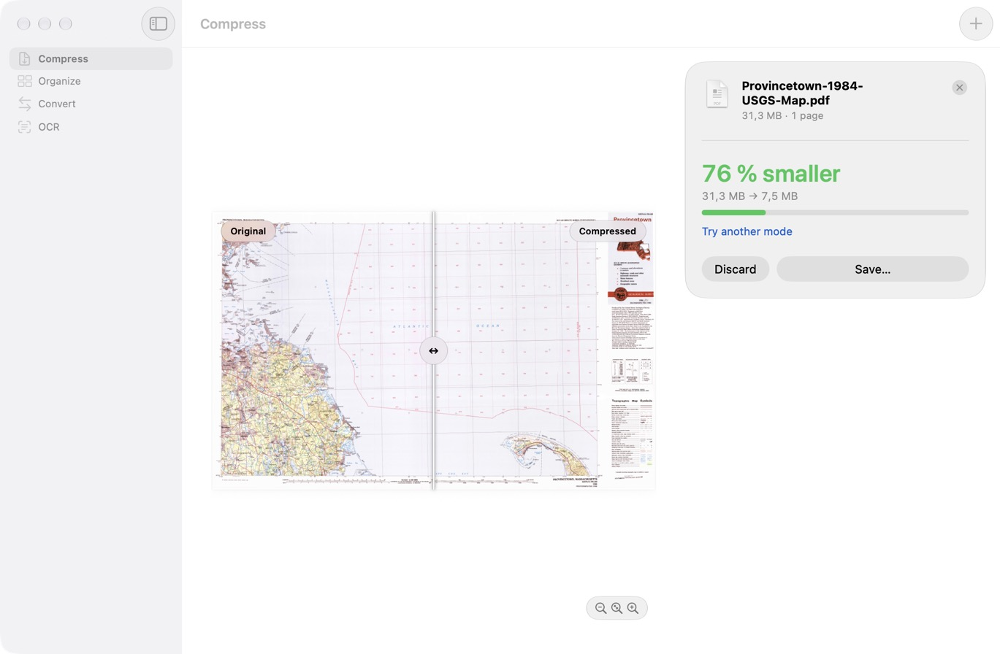
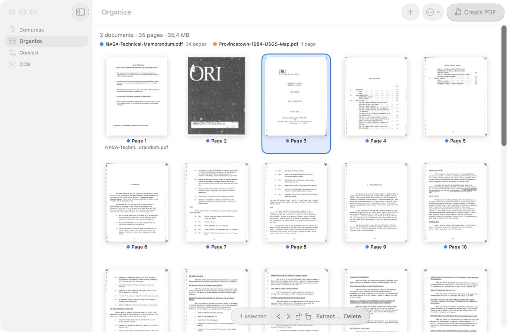
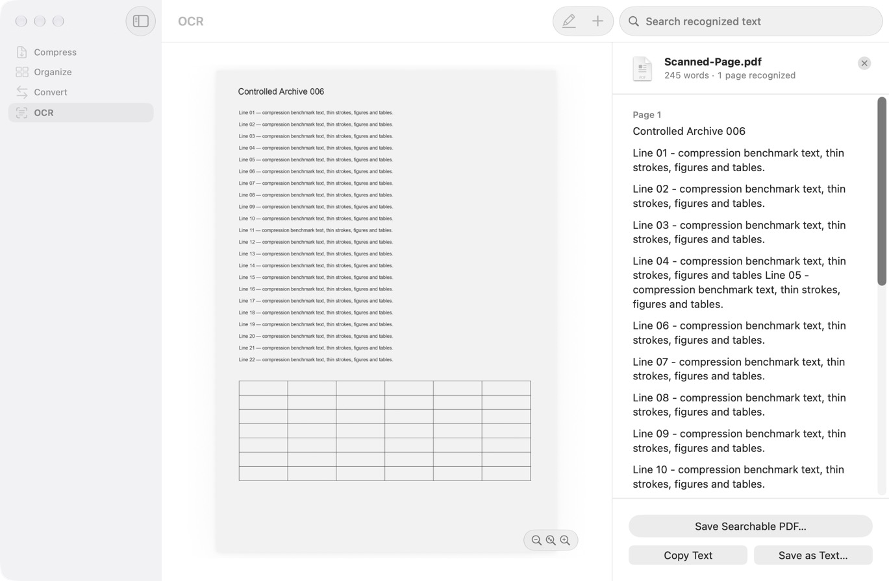

# PDFdownsize

A native macOS app that makes PDFs smaller — and handles the everyday PDF chores around it. Everything runs locally on your Mac; no file ever leaves the machine (see [Privacy](#privacy)).

The interface is German when macOS is set to German and English otherwise.



| Organize pages | Make scans searchable |
|---|---|
|  |  |

<sub>Screenshots show public-domain documents (a USGS topographic map and a NASA technical report) and a generated test page.</sub>

## What it does

- **Compress** – four modes: *Small* (for sending), *Smart* (recommended, hard to tell from the original on screen), *Quality* (keeps print resolution) and *Custom* (set resolution, JPEG quality and technique yourself). Shows an estimate before the run, supports a target size, a before/after comparison and batch compression of several PDFs.
- **Organize** – merge PDFs and images, reorder, rotate and delete pages, split a PDF, extract a selection, export pages as images.
- **Convert** – PDF pages to PNG/JPEG, or images to one PDF.
- **OCR** – adds an invisible text layer to scanned pages so the text can be searched, selected and copied; the recognized text can also be saved as a text file.

The compressor never overwrites the original and validates every result (page count, geometry, text, links, form fields) before it offers it for saving.

## Requirements

- macOS 26 or later
- A Mac with Apple silicon (the release build is arm64 only)

## Install

Download `PDFdownsize.app` from the [Releases](../../releases) page and move it to *Applications*.

**The app is currently not signed with an Apple Developer ID.** macOS will therefore refuse to open it on the first try. To allow it once:

1. Open the app (macOS shows a warning – close it).
2. Go to *System Settings → Privacy & Security*, scroll down and click **Open Anyway** next to the PDFdownsize message.
3. Confirm with your password. From then on the app opens normally.

If you prefer not to do that, build the app yourself (see below).

## Updates

From version 1.0.2 on the app updates itself: when a newer release exists it offers to download and install it and then restarts – nothing to unzip or drag around. It checks once a day; you can check by hand or switch this off in the app menu (*PDFdownsize → Check for Updates Automatically*). Updates are handled by [Sparkle](https://sparkle-project.org) and are only installed if they carry the maintainer's signature.

Versions 1.0 and 1.0.1 have no updater: download the current release once and replace the app in *Applications*.

## Privacy

Your documents never leave your Mac. The only network traffic is the update check: the app fetches a small file with the latest version number from this repository on GitHub and, if you agree to an update, downloads it from the release page. No cookies, no identifiers, no data about you or your files. Switch the check off in the app menu and the app makes no network connection at all.

## Build from source

You need Xcode 26 or later.

```bash
git clone <this repository>
cd PDFTools
xcodebuild build -project PDFTools.xcodeproj -scheme PDFTools -configuration Release
```

Or open `PDFTools.xcodeproj` in Xcode and run the `PDFTools` scheme. The Xcode project and scheme keep the working name `PDFTools`; the built product is `PDFdownsize.app`.

The PDF and image libraries are vendored under `Vendor/` as prebuilt static libraries. The only package dependency is Sparkle (the updater), which Xcode fetches automatically on the first build.

### Tests

```bash
xcodebuild test -project PDFTools.xcodeproj -scheme PDFTools -parallel-testing-enabled NO
```

Run the suite serially – several tests measure memory and timing and disturb each other when run in parallel. A full run takes roughly 35–45 minutes. The tests compare German interface texts and therefore expect a German system language.

A handful of end-to-end tests and all benchmark runs need PDF corpora that are **not** part of this repository (see `NOTICE`). Without them those tests are reported as *skipped*; everything else builds its test documents in code. They look for the corpus via the `PDFTOOLS_CORPUS_ROOT` environment variable and otherwise fall back to the maintainer's local path. `Scripts/fetch-corpus.sh` and `Scripts/bootstrap-corpus.sh` help to assemble one.

## Repository layout

| Path | Content |
|---|---|
| `PDFTools/` | App sources (SwiftUI, PDFKit, the compression engine under `PageTools/`) |
| `PDFToolsTests/` | Unit, end-to-end and benchmark tests |
| `Vendor/` | qpdf, mozjpeg, OpenJPEG, HarfBuzz, libtiff, jbig2enc – with their licenses |
| `Scripts/` | Build, corpus, benchmark and release-check scripts |

## License

Apache License 2.0 – see [LICENSE](LICENSE). Third-party components and their licenses are listed in [NOTICE](NOTICE).
